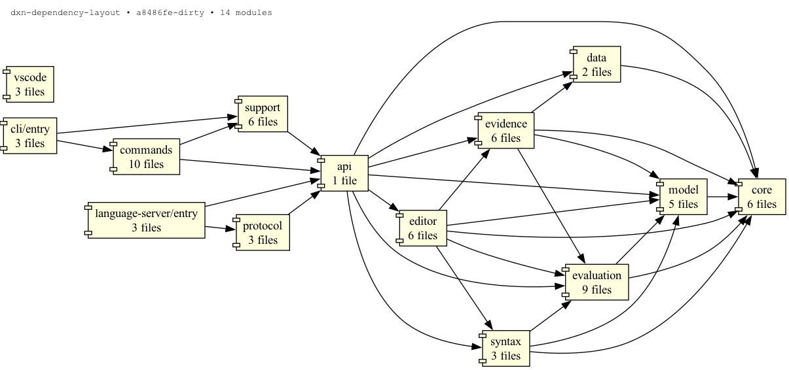

# Source dependencies

The layout follows the file dependencies reported by `clarity show`. An arrow
points from a file or folder to something it imports, including type imports.
Each Clarity module in [modules.json](../../.clarity/modules.json) corresponds to
a physical source directory; the language's public `src/index.ts` is its own node.

Source imports use `@language/*`, `@cli/*`, `@language-server/*` and `@vscode/*`.
The root [tsconfig.json](../../tsconfig.json) declares their source paths
explicitly so Clarity resolves the same dependencies as TypeScript, Vitest and
esbuild. The alias migration preserved all 252 source dependency edges.



| Language folder | Responsibility                                                                |
| --------------- | ----------------------------------------------------------------------------- |
| `core`          | AST, diagnostics, text, naming and shared wording                             |
| `model`         | Scalars, names, conditions, profiles and scopes                               |
| `evaluation`    | Type/value checking, state evaluation, expectations and combinations          |
| `syntax`        | Scanning, syntax reading, formatting and the compatible `parse()` entry point |
| `analysis`      | Context derivation, name resolution and ordered semantic analysis             |
| `data`          | JSON reading and duplicate detection                                          |
| `evidence`      | Stored-record validation, storage, fingerprints, review and renaming          |
| `editor`        | Definitions, completion, hover, cursor renaming, semantic tokens and symbols  |

`evaluation` depends on `model` and `core`. Syntax reading and formatting do not
run semantic analysis. The existing `syntax/parse.ts` entry point composes a fresh
syntax read with `analysis/semantic-analyzer.ts`, which derives record context, resolves
names, validates declarations with `evaluation/semantic-validator.ts`, analyzes
conditions and executes expectations.
Condition analysis enumerates a type's combinations only when a condition needs
judging, reusing them for the remaining conditions of that type. `evidence` uses
`data`, `evaluation`, `model` and `core`; `editor` combines syntax, evaluation and
evidence. These directory dependencies form a DAG. Shared dependencies stay in
sibling folders rather than being nested inside one of their several consumers.

`SyntaxResult`, `ResolvedResult` and `ParseResult` distinguish the stages at
compile time. Their optional, private symbol markers are erased: runtime keys,
JSON and diagnostics are unchanged, and structurally constructed files remain
compatible. A resolved result is also the input shape for checks and evaluation;
it may have errors, so evaluation retains its runtime guards. A completed parse
cannot be passed back to the syntax-to-analysis or resolution entry points.
The passes still mutate their input, so callers must not reuse a syntax alias
after giving it to analysis. TypeScript does not enforce ownership of that alias.

The unused `fieldValue` export and its helper were removed after the `PenNode`
evidence model replaced their callers. Derived-field syntax, checks, storage
validation, navigation and renaming remain supported.

The CLI's `commands/index.ts` dispatches to commands; their shared context,
reporting, stored-record helpers, wording, tables and I/O types live in
`commands/support`. The language server's `protocol` folder adapts diagnostics,
evidence and ranges to LSP. Package boundaries, executable entry points and the
language package's public exports stay the same. Tests retain their existing
behavior-oriented organization and import the relocated implementation files.

The graph covers the four TypeScript packages' source files. It does not show
external libraries, build-time bundling, process startup or runtime protocol
connections. In particular, VS Code launches the language server and CLI but does
not import their source files, so its collapsed node has no outgoing edges.
Generated tree-sitter sources and the Rust extension retain their tool-required
layouts. The grammar stays byte-for-byte identical to the revision Zed pins;
its README links to the current authoritative parser.

## Enforced boundaries

Run `make boundaries` to test the checker and validate every TypeScript and
JavaScript file under `packages/*/src`. It also runs in `make check`,
`make check-fast`, pre-commit and CI. Tests and build scripts are outside this
production-source policy; production imports of test or build code are rejected.
Native Rust and generated C dependencies are outside this check's scope.

The allowlists live in [rules.mjs](../../scripts/boundaries/rules.mjs).
Each language layer may depend on the following layers, including itself only
when listed:

| Source                                           | Allowed destinations                                                  |
| ------------------------------------------------ | --------------------------------------------------------------------- |
| `core`                                           | `core`                                                                |
| `model`                                          | `core`, `model`                                                       |
| `data`                                           | `core`, `data`                                                        |
| `evaluation`                                     | `core`, `model`, `evaluation`                                         |
| `syntax`, except parsing facades                 | `core`, `model`, syntax reading and formatting                        |
| `syntax/parse.ts`, `syntax/parse-tree-sitter.ts` | `core`, syntax reading, `analysis`                                    |
| `analysis`                                       | `core`, `model`, `evaluation`                                         |
| `evidence`                                       | `core`, `model`, `data`, `evaluation`, `evidence`                     |
| `editor`                                         | `core`, `model`, `evaluation`, `evidence`, `syntax`, `editor`         |
| Public `index.ts`                                | `core`, `model`, `data`, `evaluation`, `evidence`, `syntax`, `editor` |

Only the exact `syntax/parse.ts` and `syntax/parse-tree-sitter.ts` files have the
orchestration exception. The latter alone may import the grammar binding through
`@legacycodehq/tree-sitter-dxn`. Other syntax files cannot reach analysis indirectly
through either facade or the public barrel. New top-level source folders must be
classified explicitly.

CLI entry files may depend on commands and support; commands may depend on other
commands and support; support stays within support. Language-server entry files
may depend on protocol adapters; protocol adapters stay within protocol. VS Code
source stays within its own package. The CLI and language server may additionally
import the language through exactly `@legacycodehq/dxn-language`. Cross-package
relative paths, source aliases, file URLs and package subpaths do not substitute
for that public package name. Language implementation code cannot import its
own public barrel to bypass the layer rules.

The checker parses imports instead of searching text. It includes type-only
imports, type queries, re-exports and literal dynamic imports, resolves tsconfig
aliases and normalizes their destinations before applying the rules. Comments
and example strings are ignored. Computed module specifiers, unresolved local
imports and syntax errors fail the check. Dependency cycles remain the separate
responsibility of `make cycles`.

## Snapshots

- [Original whole-project graph](dependencies-before.mmd), including tests and docs.
- [Original source graph](source-before.dot) and [reorganized source graph](source-after.dot).
- [Folder graph as Mermaid](dependencies.mmd) and [Graphviz](dependencies.dot).

The original reorganization moved 47 source files and preserved all 251 source
dependency edges after mapping old paths to new paths. The current source and
folder graphs also include the subsequent separation of syntax reading from
analysis. Neither files nor source folders have dependency cycles.

## Regenerate

From the repository root, after staging renames so Clarity sees the current
paths rather than deleted files' historical dependencies:

```sh
clarity show packages/language/src packages/cli/src packages/language-server/src packages/vscode/src --format dot --no-stats > docs/architecture/source-after.dot
clarity show packages/language/src packages/cli/src packages/language-server/src packages/vscode/src --collapse --format mermaid --no-stats > docs/architecture/dependencies.mmd
clarity show packages/language/src packages/cli/src packages/language-server/src packages/vscode/src --collapse --format dot --no-stats > docs/architecture/dependencies.dot
dot -Tpng docs/architecture/dependencies.dot -o docs/architecture/dependencies.png
```

## Two separate language workstreams

The models are independent and both use the current DXN syntax. Choose the
model for the workstream being changed; a change in one does not require
implementing the same feature in the other. They are responsibility trees,
not execution schedules, and do not enforce mutual exclusion between tasks.

| Workstream           | Model                                                  | Root                  | Implementation                                  |
| -------------------- | ------------------------------------------------------ | --------------------- | ----------------------------------------------- |
| Current language     | [dxn-codebase.dxn](dxn-codebase.dxn)                   | `ModifyDxnGrammar`    | `packages/language` and its connected consumers |
| Lean-backed redesign | [dxn-codebase-redesign.dxn](dxn-codebase-redesign.dxn) | `RedesignDxnLanguage` | `lean/`, `packages/next` and redesigned tools   |

The current-language model retains the existing Tree-sitter-first grammar
change flow. It covers parser agreement, semantic analysis, formatting,
diagnostics, CLI, language server and both editors. It makes no Lean claims.

Every redesign change starts at `ModifyLeanSpecification`: review Lean semantics
and the syntax/implementation decisions in the design notebook before implementing
anything. Its children cover Lean verification, syntax, semantic analysis,
evaluation, refactoring, stored evidence, formatting and the shared toolchain.
Syntax-only changes may keep semantic definitions unchanged.

The canonical implementation checklist and review/evidence conventions are in
[`lean/README.md`](../../lean/README.md#implementing-a-specification-across-the-toolchain).
The redesigned model is its component-level map. Parser diagnostics and possible
parser fixes are explicit and separate from checker diagnostics and checker fixes.
The parser currently stops at the first syntax error; parser fixes, evaluation
and stored evidence remain open responsibilities, not implemented capabilities.

`CheckSpecificationAgreement` compares semantic implementation with executable
Lean. `CheckParserAgreement` compares the core parser and Tree-sitter.
`CheckRefactoringAgreement` compares transformations and refusals. Evaluation
agreement is required when an evaluator is specified. Source edits, formatting
and diagnostic presentation also need their own implementation tests.

Common consumers appear once beneath `ReviewLanguageToolchain`: the shared
diagnostic contract, editor features, CLI, language server, both extensions,
and build/distribution. This keeps the expanded tree compact. It is a review
obligation tree, not a complete dependency graph or execution schedule: review
combined syntax, semantic, correction and refactoring impact at these shared
consumers. Both interfaces must use shared implementations and agree where their
behavior mirrors; the language server then reaches both clients. Each extension
retains separate direct-syntax and language-client verification responsibilities.

All tool nodes in the redesign model mean tools for the redesigned language:
its formatter, CLI, language server and editor extensions. These are target
responsibilities, not assertions that those integrations already exist.
No edge connects to `packages/language`, and no migration or cutover task is
included. Prototype tests do not verify redesigned tool behavior merely because
the tools have the same names. Verification must exercise the redesigned runtime
and syntax. Deployment and migration between implementations can be planned
separately when needed.

The redesign also covers evaluation, its own stored records and
refactoring. Refactoring is shared language behavior serving CLI and editors.
Lean rename properties include validity, value mapping, inverse, identity and
composition; those laws do not automatically apply to every refactoring.
Source-edit precision needs implementation tests. A source-rename proof does
not establish that records were transformed correctly. Importing prototype
records is outside this model.

`TreeSitterChange` describes the required edit rather than the origin of a
redesign decision. The redesign model permits `none` for semantic-only changes.
Both models retain the Zed grammar-pin and VS Code direct-syntax reviews,
separate from language-server behavior.

Each `has` edge means “review this responsibility because of this upstream
change”, not a mandatory edit. Record **changed**, **reviewed, no change needed**,
or **not yet implemented**, with a reason and affected paths, in the change
summary. These review outcomes do not establish that verification passed.

Implementation status and verification evidence remain separate records.
`CodingAgent` records `AutomatedVerification`: command, result (`unverified`,
`passed` or `failed`), revision, repository-relative saved output and timestamp.
Missing evidence means unverified. Editor verification nodes require automated
checks and developer checks in the actual editor, including unsaved and
incomplete source. Automated success does not establish human verification;
the human actor and record remain to be modeled. Review a `keep` outcome too.

Print either independent tree with the current CLI:

```sh
dxn check docs/architecture/dxn-codebase.dxn
dxn tree docs/architecture/dxn-codebase.dxn

dxn check docs/architecture/dxn-codebase-redesign.dxn
dxn tree docs/architecture/dxn-codebase-redesign.dxn
```

Migrate the models themselves only when the redesigned language supports them.
